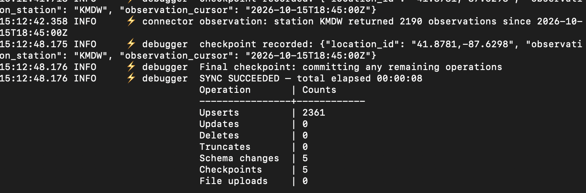

# Connector SDK workshop: weather data

Build, debug and (optionally) deploy a Fivetran connector for weather data from [api.weather.gov](https://api.weather.gov), using a free Claude account and a condensed instructions file.

## Setup

1. Create a local directory called `fivetran`.
2. Download these files from [fivetran-clgritton/DD-26](https://github.com/fivetran-clgritton/DD-26) into `fivetran`:
   - `Connector_SDK_Assistant.md`
   - `nws_api.json`: the API spec from api.weather.gov.
   - `view_data.py`: optional script to show test data with DuckDB

## Let's make a connector!

1. Open Claude in a browser.
2. Start a new chat and upload the two files: `Connector_SDK_Assistant.md` and `nws_api.json`.
3. Type:

   > I want to make a Fivetran connector for the weather API. I want to start with station KDET but I want to be able to add a list of stations later. Please make sure that the first run completes in less than a minute.

4. Claude will generate a connector file. Follow its instructions for testing. It will probably ask you to install Connector SDK. The simple version is:

   ```bash
   pip install fivetran-connector-sdk
   ```

## Debugging

A successful debug will look something like this:



## View the output

Debugging creates a local DuckDB file. There are at least two options for viewing the data:

- Ask Claude to generate a Python script that reads some records from DuckDB, or use `view_data.py` from the workshop repo.
- Use a generic tool like [DBeaver](https://dbeaver.io) to open the database file at `/files/warehouse.db`.

## Deploy to Fivetran

> This step is optional. Only do it if you have a Fivetran account with a destination already set up.

You can ask Claude for the command, or run:

```bash
fivetran deploy --api-key <YOUR_API_KEY> --destination <DESTINATION_NAME> --connection weather_api
```
